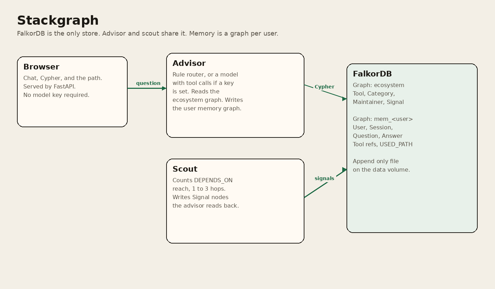
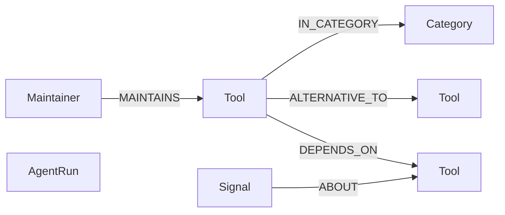
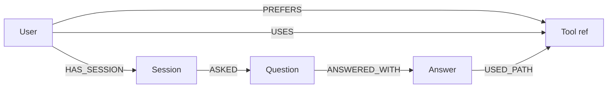

# Stackgraph

Stackgraph answers questions about a small dev-tool corpus by running Cypher on FalkorDB. If FalkorDB is down, the API returns 503 and the UI stops. There is no second database.

Two agents share that database. Scout counts how many tools reach another tool through `DEPENDS_ON` (1 to 3 hops) and writes a `Signal` node. Advisor reads those signals, the dependency edges, and the alternative edges, then stores the question on a per-user memory graph.

Primary track: Agents That Act on Connected Data. Secondary track: Agent Memory and Coordination.

**Demo video:** <https://youtu.be/L1gNyQyUcp8>

**Live demo:** <https://stackgraph.onrender.com> (health check at <https://stackgraph.onrender.com/api/health>). It runs on Render's free plan, so the first request after it sleeps can take about a minute while the container wakes up, and the memory graph resets when the container is replaced.

## Setup

Docker and Docker Compose are enough for the demo. Python 3.11 on the host is only needed if you want to run pytest outside the API container.

```
docker compose build
docker compose up -d
```

The UI is at <http://127.0.0.1:8091>. FalkorDB listens on port 6379. The image also serves FalkorDB Browser on container port 3000, mapped to host port 3391.

`Dockerfile.render` is a single container for a free Render web service: FalkorDB and the API together, listening on `PORT`. Steps are in `docs/DEPLOY.md`.

On startup the API MERGEs `seed/catalog.json` into the `ecosystem` graph and runs scout. The catalog was fetched from the public npm registry and PyPI at `2026-10-15T18:16:27Z`. After that, answers come from the graph, not from the JSON file.

Stop it with `docker compose down`. The named volume keeps the graphs. `docker compose down -v` deletes that volume.

### Tests

With FalkorDB already on port 6379:

```
python -m venv .venv
.venv/bin/pip install -r requirements.txt
.venv/bin/python -m pytest
```

Tests use the graph name `sg_test_eco`, not `ecosystem`.

### No model key

Leave `LLM_API_KEY` and `LLM_BASE_URL` empty. A rule router maps the question to the Cypher in `app/graph/cypher.py`. That is the demo path.

To use a model, put an OpenAI-compatible base URL and key in the environment. Compose reads a `.env` file. See `.env.example`. Groq's OpenAI-compatible URL is `https://api.groq.com/openai/v1`. Set `LLM_MODEL` to the model name that host expects. If the call fails, advisor keeps the rule router answer and says so.

Copy `.env.example` to `.env` and fill it in. Do not commit `.env`.

### Refresh the registries

```
python scripts/ingest.py
python scripts/ingest.py refresh
```

`refresh` needs network. It rewrites `seed/catalog.json` from npm and PyPI, then MERGEs it. It keeps editorial alternative edges and the Moment signal.

## Graph data model

One FalkorDB instance. Two kinds of graph.

`ecosystem` is shared. `mem_<user>` is one graph per user id. FalkorDB edges cannot cross graphs, so a memory graph stores Tool nodes that are references (`ref: true`, same package name) rather than pointers into `ecosystem`.

```
Browser -> Advisor -> ecosystem
Scout -> ecosystem
Advisor -> mem_<user>
```



Schema of the `ecosystem` graph:



Schema of each `mem_<user>` graph:



### Proof the graph does the work

* Stop FalkorDB and `/api/ask` returns 503. There is no fallback store or cached answer.
* Every answer in the UI shows the exact Cypher that ran and the node path it returned.
* Scout writes `Signal` nodes and advisor only learns about blast radius by reading them back from the graph, so the two agents coordinate through FalkorDB alone.

### Ecosystem nodes

* `Tool`: `id`, `name`, `ecosystem` (`npm` or `pypi`), `package`, `summary`, `license`, `repo`, `version`, `legacy`, `origin`, `aliases`, `ref`
* `Category`: `id`, `name`
* `Maintainer`: `id`, `name`, `handle`, `url` (public GitHub account chosen for the seed, not a live org-membership check)
* `Signal`: `id`, `kind`, `source`, `score`, `ts`, `detail`, `origin`, `agent`
* `AgentRun`: `id`, `agent`, `ts`, `signals_written`

### Ecosystem edges

* `(:Tool)-[:DEPENDS_ON {kind, spec}]->(:Tool)` where `kind` is `runtime` or `peer`. Direction is dependent to dependency.
* `(:Tool)-[:ALTERNATIVE_TO {reason}]->(:Tool)` stored in both directions. The reason is a curated comparison, not a registry field.
* `(:Tool)-[:IN_CATEGORY]->(:Category)`
* `(:Maintainer)-[:MAINTAINS]->(:Tool)`
* `(:Signal)-[:ABOUT]->(:Tool)`

The committed catalog has 70 tools (54 npm, 16 PyPI), 38 `DEPENDS_ON` edges, 61 alternative pairs (122 directed edges), 23 categories, 62 maintainers, and 1 seed signal. After scout, a count query on that load reported 20 signals (the seed signal plus 19 blast radius signals).

`DEPENDS_ON` is the intersection of registry `dependencies` and `peerDependencies` (npm) or non-extra `requires_dist` (PyPI) with this corpus. `next` 16.4.1 lists `@playwright/test` as a peer dependency, so that edge is in the graph.

The Moment signal points at <https://momentjs.com/docs/#/-project-status/>. Its score is a flag (1 means the signal exists), not a measurement. Scout scores are hop counts inside this corpus, not download numbers.

### Memory nodes and edges

* `(:User {id})-[:HAS_SESSION]->(:Session {id, started_at})`
* `(:Session)-[:ASKED]->(:Question {id, text, ts, intent})`
* `(:Question)-[:ANSWERED_WITH]->(:Answer {id, text, ts, mode, cypher_json})`
* `(:Answer)-[:USED_PATH {ord, via}]->` a `Tool`, `Signal`, `Maintainer`, `Category`, or `User` reference
* `(:User)-[:PREFERS {ts, note}]->(:Tool)` and `(:User)-[:USES {ts, note}]->(:Tool)`

## Cypher and algorithms

Parameters use FalkorDB's `$name` form. The UI shows the same query with literals filled in.

Alternatives:

```
MATCH (t:Tool {name: $name})-[rel:ALTERNATIVE_TO]->(alt:Tool)
OPTIONAL MATCH (m:Maintainer)-[:MAINTAINS]->(alt)
OPTIONAL MATCH (alt)-[:IN_CATEGORY]->(c:Category)
RETURN alt.id AS id, alt.name AS name, alt.ecosystem AS ecosystem,
       alt.summary AS summary, rel.reason AS reason,
       m.name AS maintainer, m.handle AS handle, c.name AS category
ORDER BY alt.name
```

What depends on a tool, as paths and as a count:

```
MATCH (t:Tool {name: $name})
MATCH p = (dep:Tool)-[:DEPENDS_ON*1..3]->(t)
RETURN p
LIMIT 25
```

```
MATCH (t:Tool {name: $name})
OPTIONAL MATCH (dep:Tool)-[:DEPENDS_ON*1..3]->(t)
RETURN t.id AS id, t.name AS name, count(DISTINCT dep) AS dependents
```

Shortest path. FalkorDB rejected `shortestPath` inside `MATCH`, so it sits in `RETURN`. If the mixed relationship pattern fails, advisor retries with only `DEPENDS_ON`:

```
MATCH (a:Tool {name: $from_name}), (b:Tool {name: $to_name})
RETURN shortestPath((a)-[:DEPENDS_ON|ALTERNATIVE_TO*1..8]-(b)) AS p
```

PageRank, then in-degree only if that procedure errors:

```
CALL algo.pageRank('Tool', 'DEPENDS_ON')
YIELD node, score
RETURN node.id AS id, node.name AS name, node.ecosystem AS ecosystem, score
ORDER BY score DESC
LIMIT 10
```

```
MATCH (t:Tool)
OPTIONAL MATCH (d:Tool)-[:DEPENDS_ON]->(t)
RETURN t.id AS id, t.name AS name, t.ecosystem AS ecosystem, count(DISTINCT d) AS score
ORDER BY score DESC, t.name
LIMIT 10
```

Community detection (label propagation on alternative edges):

```
CALL algo.labelPropagation({nodeLabels: ['Tool'], relationshipTypes: ['ALTERNATIVE_TO'], maxIterations: 10})
YIELD node, communityId
RETURN node.id AS id, node.name AS name, communityId
ORDER BY communityId, node.name
```

Maintainers of a tool and its dependencies out to 2 hops:

```
MATCH (root:Tool {name: $name})
OPTIONAL MATCH (root)-[:DEPENDS_ON*1..2]->(dep:Tool)
WITH root, collect(DISTINCT dep) AS deps
WITH [root] + deps AS tools
UNWIND tools AS t
OPTIONAL MATCH (m:Maintainer)-[:MAINTAINS]->(t)
RETURN DISTINCT t.id AS id, t.name AS name, t.ecosystem AS ecosystem,
       m.name AS maintainer, m.handle AS handle, m.url AS url
ORDER BY t.name
```

Scout writes:

```
MATCH (t:Tool {id: $tool_id})
MERGE (s:Signal {id: $id})
SET s.kind = 'blast_radius', s.source = 'scout', s.origin = 'derived',
    s.score = $score, s.ts = $ts, s.agent = 'scout', s.detail = $detail
MERGE (s)-[:ABOUT]->(t)
RETURN s.id AS id, t.name AS tool, s.score AS score
```

Memory preference (`USES` is the same shape with that relationship type):

```
MERGE (u:User {id: $user})
MERGE (t:Tool {id: $tool_id})
SET t.name = $tool_name, t.ecosystem = $ecosystem, t.ref = true
MERGE (u)-[r:PREFERS]->(t)
SET r.ts = $ts, r.note = $note
RETURN u.id AS user, t.name AS tool, r.note AS note
```

Recall:

```
MATCH (u:User {id: $user})-[r:PREFERS|USES]->(t:Tool)
RETURN type(r) AS rel, t.name AS tool, t.ecosystem AS ecosystem, r.ts AS ts, r.note AS note
ORDER BY r.ts DESC
```

Every answer also MERGEs a `Session`, `Question`, and `Answer`, then `USED_PATH` edges. Those statements are in `app/graph/cypher.py` (`SAVE_TURN`).

On the load used for development, PageRank after scout returned react `0.033911`, typescript `0.027305`, express `0.019278`. A second call returned the same three scores. Those numbers are this corpus and this procedure, not registry traffic.

## API

* `GET /api/health`
* `GET /api/examples`
* `POST /api/ask` with `question`, `user_id`, `session_id`
* `POST /api/scout`
* `GET /api/memory/{user_id}`
* `GET /docs` for the generated schema

Sample questions are the chips in the UI. `docs/DEMO_SCRIPT.md` is the click path.

## CI

The workflow file is `ci/github-actions-ci.yml`. It is not under `.github/workflows`, because the push token used to publish this repo cannot update that directory. Copy the file there if you want GitHub Actions to run it.

## AI-use disclosure

Cursor's coding agent (Grok 4.7) drafted this repository, including the Cypher, the seed loader, the UI, and these docs. Aman Tebriwal is the project owner and the person who has to explain the graph model, the queries, and the architecture. The registry fields in `seed/catalog.json` were fetched from npm and PyPI by `scripts/build_catalog.py` at the timestamp in that file. Alternative edges were chosen in the editorial list, not by the registries. The no-key demo does not call a model.

## License

MIT. Copyright (c) 2026 Aman Tebriwal. See `LICENSE`.
